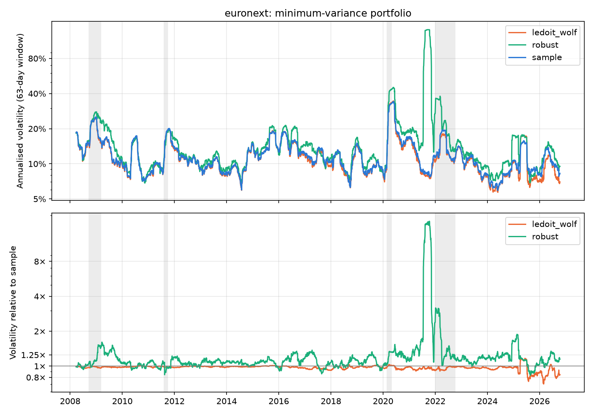
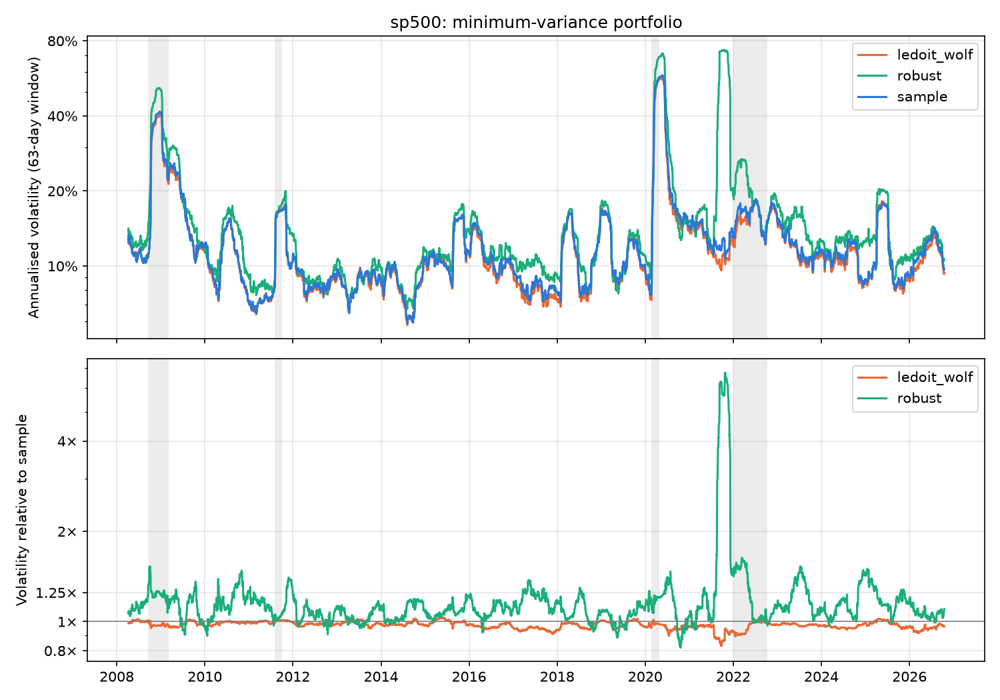
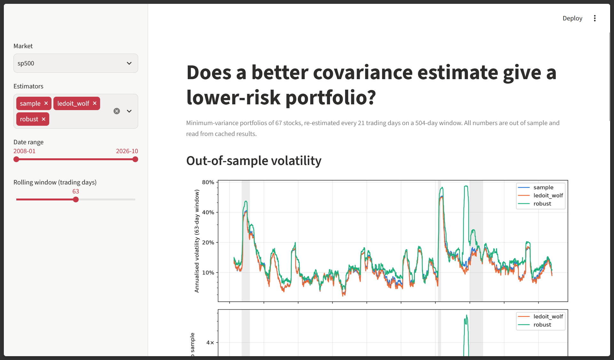

# Robust Covariance Estimation

**Does a better (robust) covariance estimate give a lower-risk portfolio out of sample?**

<!-- > **Status: work in progress.** Results for all three estimators are final; the significance tests are still to come. -->

<picture>
  <source media="(prefers-color-scheme: dark)" srcset="figures/volatility_euronext_dark.png">
  
</picture>
<picture>
  <source media="(prefers-color-scheme: dark)" srcset="figures/volatility_sp500_dark.png">
  
</picture>

*Rolling 63-day annualised volatility of the minimum-variance portfolio (top) and its ratio to the sample-covariance portfolio (bottom), log scales. Shaded: GFC 2008-09-15 to 2009-03-09, COVID 2020-02-20 to 2020-04-30, 2022 sell-off 2022-01-03 to 2022-10-12.*

## Finding

The pre-specified robust estimator raises risk: it is about 10% more volatile than the sample-covariance portfolio in a typical month and 30% (S&P 500) to 75% (Euronext) more volatile overall. Its pairwise correlations discount the crash days that drive realised risk, and in mid-2021 they assembled into a nearly singular matrix that min-variance exploited with leverage up to 108. Ledoit–Wolf covariance estimation, on the other hand, lowers out-of-sample volatility by about 2% in both markets, in all but one or two calendar years, though not yet tested for significance.

### Summary, out of sample 2008–2026

Euronext (N = 67):
<!-- euronext_table:start -->
| estimator   |   pooled_vol |   vol_ratio |   median_monthly_ratio |   median_leverage |   max_leverage |
|:------------|-------------:|------------:|-----------------------:|------------------:|---------------:|
| ledoit_wolf |        0.124 |       0.979 |                  0.98  |             2.487 |          4.06  |
| robust      |        0.22  |       1.746 |                  1.101 |             3.294 |        108.54  |
| sample      |        0.126 |       1     |                  1     |             2.678 |          4.322 |
<!-- euronext_table:end -->
S&P 500 (N = 67):
<!-- sp500_table:start -->
| estimator   |   pooled_vol |   vol_ratio |   median_monthly_ratio |   median_leverage |   max_leverage |
|:------------|-------------:|------------:|-----------------------:|------------------:|---------------:|
| ledoit_wolf |        0.14  |       0.975 |                  0.978 |             2.659 |          3.635 |
| robust      |        0.186 |       1.298 |                  1.1   |             3.43  |         42.449 |
| sample      |        0.143 |       1     |                  1     |             2.871 |          4.688 |
<!-- sp500_table:end -->

`pooled_vol`: annualised standard deviation of all daily portfolio returns. `vol_ratio`: pooled volatility relative to the sample-covariance portfolio. `median_monthly_ratio`: median over rebalances of the 21-day volatility ratio to the sample-covariance portfolio. Leverage is gross leverage, `sum |w_i|`.

## Method

Every 21 trading days (252 / 12, i.e. monthly on average), for each market separately:

1. Estimate the covariance matrix of the N = 67 stocks on the past 504 trading days (about two years) of daily log returns, using only data before the rebalance day. Three estimators:
   - **Sample covariance.**
   - **Ledoit–Wolf shrinkage** (baseline, scikit-learn): `S_LW = (1 - d) S + d mu I`, with `mu = tr(S) / N` and the intensity `d` chosen to minimise the expected squared error. This pulls the small eigenvalues of `S` up towards `mu`.
   - **Robust:** Qn scales with pairwise Gnanadesikan–Kettenring correlations, `rho = (Qn(u)^2 - Qn(v)^2) / (Qn(u)^2 + Qn(v)^2)`, where `u` and `v` are the sum and difference of the standardised returns. Eigenvalues of the correlation matrix are floored at `1e-4` and the diagonal is rescaled to 1, so the matrix is invertible.
     Qn is computed without forming all T(T-1)/2 pairwise distances: on a sorted series the number of pairs within distance t is a sum of binary searches (`searchsorted`), and bisection on t finds the k-th smallest distance. This runs in JAX, with `vmap` over the 4,489 series per rebalance (67 assets plus 2 x 2,211 sum and difference series) and `jit`, about 3 s per rebalance on a laptop CPU, against about 23 s for a NumPy partition over all pairs.
2. Compute minimum-variance weights, `w = S^-1 1 / (1' S^-1 1)` (the Lagrange solution of minimising `w' S w` subject to `1' w = 1`). Short positions are allowed; gross leverage `sum |w_i|` is recorded.
3. Hold for the next 21 trading days, rebalancing daily back to `w`, and record the realised volatility `std(w' r_t) * sqrt(252)` on simple returns (`expm1` of log returns). Estimation uses log returns, evaluation simple returns; at daily frequency the difference is negligible.
4. Roll forward 21 days and repeat. A final partial block shorter than 21 days is dropped.

Full-period volatility is computed from the pooled daily portfolio returns, not by averaging monthly volatilities.

No parameter is tuned towards a preferred estimator: the window, holding period, eigenvalue floor, start date and stock selection were fixed before any estimator comparison.

Results are written to SQLite at `results/backtest.sqlite`.

<!-- ## Why the robust estimator blows up

The robust estimator is reported exactly as specified in advance, including its failures.

- Pairwise Gnanadesikan–Kettenring correlations are not jointly consistent, so the assembled correlation matrix can have negative eigenvalues. In the windows ending July 2021 (Euronext) and August 2021 (S&P 500) the smallest eigenvalue is -0.0036 and -0.0009.
- The `1e-4` eigenvalue floor makes the matrix invertible but leaves it nearly singular: condition number about 260,000, against about 650 for the Pearson correlation matrix of the same window.
- Minimum-variance weights are `S^-1 1 = sum_k v_k (v_k' 1) / lambda_k`, so the direction with the floored eigenvalue is amplified roughly 500 times. Gross leverage jumps to 108 (Euronext, 2021-07-16) and 42 (S&P 500, 2021-08-11), and realised volatility in those months to 240% and 125%.
- The "riskless" long-short combination (the eigenvector of the smallest eigenvalue) is an artefact: its actual variance in the same estimation window is 0.39 and 0.31 in correlation units (a single stock has 1), not about 0. It is spread over 14–18 stocks, so it is a property of the estimator rather than of one event.
- Outside these blow-ups the robust portfolio is still 5–20% more volatile than the sample portfolio in most years. The robust correlations describe calm days and discount crash days (for example CCI–JPM: 0.08 robust against 0.49 Pearson in the window containing March 2020), while realised volatility is driven precisely by the crash days. -->

## Data

- Daily closing prices from Yahoo Finance (via `yfinance`), 2006-01-01 to 2026-11-06.
- The start date is chosen so that, after the first 504-day estimation window, the out-of-sample period begins in January 2008 and the 2008 financial crisis is also fully out of sample.
- Constituents are today's S&P 500 and Euronext 100 lists, scraped from Wikipedia.
- Cleaning (`scripts/logreturns.py`) is done in the following order:
  1. keep dates from 2006-01-01 on;
  1. drop tickers with 2% or more missing prices over that period;
  1. drop dates on which >20% tickers are missing (exchange holidays);
  1. forward-fill remaining price gaps for at most 3 days, and drop tickers that still have gaps (like later listings);
  1. drop tickers with more than 5% zero returns.
- Universe (`scripts/make_universe.py`): all 67 Euronext tickers that survive cleaning (of 101), and a fixed-seed random draw of 67 from the 388 surviving S&P 500 tickers, so both markets have the same ratio of stocks over observations (N/T).

The raw data is not in this repo, but can be retrieved using `yfinance`. 
The selected tickers are listed in `universe/`.

<!-- ## Results storage

Results are written to SQLite at `results/backtest.sqlite`.
All tables have keys (market, estimator, date):

| Table | Contents |
|---|---|
| `rebalances` | realised volatility and gross leverage per rebalance |
| `weights` | weight per ticker per rebalance |
| `daily_returns` | daily portfolio return |

Summary statistics are not stored -->

## Caveats

- **Survivorship and look-ahead in the universe.** Every stock is a current index member with a full price history since 2006, so failed and delisted companies are missing. Absolute volatility levels are therefore too low; the comparison between estimators is less affected, but not immune.
- **Single holding period and window.** Results are for 21-day holding and a 504-day window only; no sensitivity sweep.
- **Point estimates.** Differences in volatility between estimators are reported without confidence intervals.
- **Fixed eigenvalue floor.** The `1e-4` floor in the robust estimator is a choice, not an estimate, and it is too weak to keep the robust correlation matrix well conditioned (see above). It was not changed after seeing the results.
- **Non-synchronous holidays.** Euronext stocks trade on several exchanges with different holidays. Forward-filled prices give zero returns on those days, which pulls cross-country correlations slightly towards zero for all three estimators.
<!-- - **2008 is out of sample, 2007 is not.** The first estimation window (2006–2007) contains no crisis data, so the first out-of-sample months test estimators fitted on a calm period.
- **No transaction costs.** Turnover differs between estimators and is not penalised.
- **Daily rebalancing to fixed weights** within each 21-day holding period, rather than buy-and-hold.
- **Ledoit–Wolf target.** Shrinkage is towards a scaled identity (equal variances, zero correlation); other targets (constant correlation, factor models) are not tested.
- **Local-currency returns.** Oslo-listed stocks are in NOK, the rest of the Euronext universe in EUR. -->

<!-- ## Repository layout

```
src/robust_covar/   package: estimators, weights, backtest, storage, plots
scripts/            data collection, cleaning, universe draw, and the backtest run
app/                Streamlit dashboard (reads cached results only)
tests/              unit tests
universe/           selected tickers per market
results/            cached backtest results (SQLite)
figures/            plots used in this README
``` -->

## Dashboard

<picture>
  <source media="(prefers-color-scheme: dark)" srcset="figures/dashboard_dark.png">
  
</picture>

A Streamlit app for exploring the cached results: choose a market, estimators, a date range and the rolling window; the summary table is recomputed for the selected range (for example, excluding 2021 shows whether the robust estimator's gap survives without its blow-up), and the top-15 holdings with gross leverage can be inspected at any rebalance. The app only reads from SQLite with parameterised queries; it never reruns the backtest.

```bash
uv run --extra app streamlit run app/dashboard.py
```

## How to run

```bash
uv sync                                        # install
uv run pytest                                  # tests
uv run --extra data python scripts/collect_data.py   # download raw prices
uv run python scripts/logreturns.py            # raw prices -> log returns
uv run python scripts/make_universe.py         # fixed-seed universe draw
uv run python scripts/run_backtest.py          # all markets and estimators -> results/
uv run python scripts/run_backtest.py --market sp500 --estimator sample   # one run
uv run --extra app streamlit run app/dashboard.py    # dashboard
```

